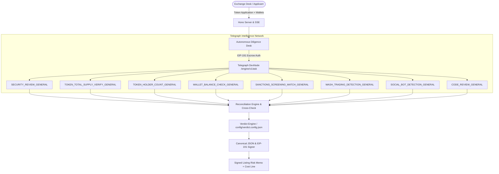

# ListingGuard 🛡️

> **Autonomous Token-Listing Risk Desk powered by Telegraph Machine Intelligence**  
> *Telegraph Hackathon Season II — Apps & Agents Track (Mission 01: Exchange)*

[]()
[]()
[]()
[]()

---

## 1. Problem & Context
Crypto exchanges review dozens of new token applications weekly. Listing reviews currently require manual analyst workflows taking **days to weeks**, juggling disjoint vendors (audit tools, blockchain explorers, sanctions screening lists, social analytics). In-house models are expensive and billed per-seat. Crucially, traditional diligence leaves **no verifiable cryptographic audit trail** of who attested to what or how much it cost.

**ListingGuard** transforms listing reviews into an autonomous, machine-to-machine desk. An applicant enters a token contract address along with disclosed insider wallets, core team names, social handle, and code repository. An autonomous desk purchases parallel, independent diligence checks from competing, ranked Telegraph miners using micro-escrow payments on Sepolia testnet. It reconciles the findings and outputs a **cryptographically signed Listing Risk Memo** stamped with a clear decision (**LIST**, **REVIEW**, or **REJECT**), cryptographic receipts, and an exact **cost line** at the bottom (cents and seconds instead of weeks of manual work).

---

## 2. Architecture



---

## 3. Supported Checks & Telegraph Intents

| Check ID | Telegraph Intent | Target Entity | Required? |
|---|---|---|---|
| `security` | `SECURITY_REVIEW_GENERAL` | Smart contract bytecode / address | **Yes** |
| `supply` | `TOKEN_TOTAL_SUPPLY_VERIFY_GENERAL` | Total token supply on chain | **Yes** |
| `holderCount` | `TOKEN_HOLDER_COUNT_GENERAL` | Unique token holder breadth | **Yes** |
| `wash` | `WASH_TRADING_DETECTION_GENERAL` | Volume authenticity & wash trade % | **Yes** |
| `walletBalance` | `WALLET_BALANCE_CHECK_GENERAL` | Disclosed insider/team wallets | If wallets given |
| `sanctions` | `SANCTIONS_SCREENING_MATCH_GENERAL` | Core team / signer legal names | If names given |
| `social` | `SOCIAL_BOT_DETECTION_GENERAL` | Project Twitter/X handle | If handle given |
| `codeReview` | `CODE_REVIEW_GENERAL` | GitHub repository codebase | If repo given |

---

## 4. Prerequisites & Setup

### Requirements
- **Node.js >= 20.0.0** (`node --version`)
- Throwaway **Sepolia Testnet Wallet** with a little Sepolia ETH (for gas) and test USDC ([faucet](https://anjoman.ai/dashboard/faucet))
- Star the official bounties repo: [github.com/telegraphprotocol/bounties](https://github.com/telegraphprotocol/bounties)

### Quick Start
```bash
# 1. Clone & install dependencies
git clone https://github.com/dange/listingguard.git
cd listingguard
npm install

# 2. Configure environment
cp .env.example .env
# Edit .env with your throwaway Sepolia private key

# 3. Fund Escrow (one-time approval and deposit of 5 USDC)
npm run deposit

# 4. Start local server & interactive Web UI
npm run dev
# Visit http://localhost:8787 in your browser
```

---

## 5. CLI Usage & Commands

### Generate a Listing Memo via CLI
```bash
# Run against Circle USDC on Ethereum mainnet
npm run memo -- 0xA0b86991c6218b36c1d19D4a2e9Eb0cE3606eB48 --symbol=USDC --social=circle

# Run with insider wallets, team names, and dual-miner crosscheck
npm run memo -- 0x1f9840a85d5aF5bf1D1762F925BDADdC4201F984 \
  --symbol=UNI \
  --names="Hayden Adams" \
  --social=Uniswap \
  --repo=https://github.com/Uniswap/v3-core \
  --crosscheck

# Offline / Demo Mode (uses deterministic MockProvider without consuming testnet funds)
npm run memo -- 0xA0b86991c6218b36c1d19D4a2e9Eb0cE3606eB48 --mock
```

### Verify Memo Cryptographic Authenticity
```bash
npm run verify -- data/memos/memo_example.json
```
This recomputes the canonical JSON `keccak256` content hash and audits the EIP-191 personal_sign signature against the signer's on-chain public address.

### Run Historical Backtest
```bash
# Evaluates verified mainnet tokens (good tokens vs documented rug pulls)
npm run backtest -- --mock
```
Writes a full report to `backtest-report.md`.

### Run Test Suite
```bash
npm test
```

---

## 6. How Verification Works

Every Listing Risk Memo is verifiable independently without trusting ListingGuard:
1. **Signal Inspection:** Each check returns a `signal_hash`. The raw miner inputs and outputs can be inspected directly on Telegraph:
   ```http
   GET https://devnode.telegraphprotocol.com/engine/v1/signal/{signalHash}
   ```
2. **Escrow Delivery Proofs:** Payment receipts returned via `X-PAYMENT-RESPONSE` and multi-miner fulfillments can be audited on-chain:
   ```http
   GET https://devnode.telegraphprotocol.com/v1/blocks/{epochId}/deliveries/{receiptHash}
   ```
3. **Memo Integrity:**
   ```bash
   npm run verify -- <memo.json>
   ```

---

## 7. Limitations & Honest Disclosures
- **Testnet Micropayments, Mainnet Data:** All intelligence queries inspect real production chains (Ethereum, Polygon, Arbitrum), while payment settlements execute on Ethereum Sepolia testnet escrow.
- **Disclosed Wallets Only:** Insider concentration is calculated strictly from the wallets disclosed by the applicant ($Total Disclosed \div Total Supply$), not exhaustive global graph deanonymization.
- **Judgment-Class Miners:** Intelligence is generated by competitive ranked machine learning models and heuristics, not formal verification proofs.
- **Public Telegraph Feed:** Queries submitted to Telegraph appear on the network's public daemon feed; confidential or non-public material should not be queried.
